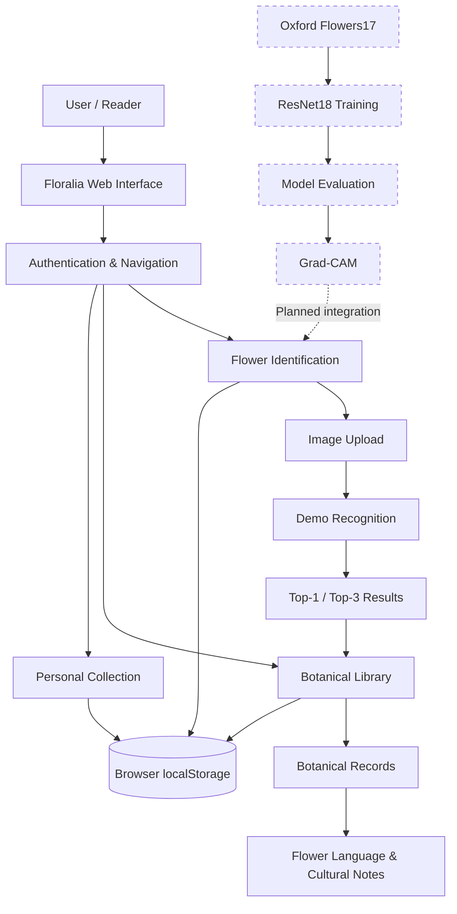

# 🌿 Floralia Library

<div align="center">


# Floralia Library
### 花与书页 · An AI-Powered Botanical & Literary Library

**Where Flowers Bloom, Stories Unfold.**

*让一朵花，翻开一页书。*

An exploration of **flower recognition, botanical knowledge, and the literature hidden within nature.**


</div>

---

## 📖 About Floralia

**Floralia Library** is an evolving flower-recognition and digital botanical library that brings together **computer vision, botany, literature, and cultural symbolism**.

Inspired by classical European libraries and botanical manuscripts, the project reimagines flower identification as the experience of opening an illustrated book.

A photograph becomes an entry into a botanical collection, where a flower is introduced through its scientific identity, distinguishing characteristics, cultural meanings, and literary associations.

Rather than ending with a classification label, Floralia aims to invite further exploration.

> *Every flower has a name. Some have stories worth remembering.*

### 🌸 项目简介

**Floralia Library · 花与书页** 是一个融合计算机视觉、植物学与文学文化的花卉智能识别项目。

项目以欧洲古典藏书馆和植物图鉴为设计灵感，将花卉识别转化为一次翻阅书页的体验。

用户上传花卉照片后，可以进入相应的植物资料页面，探索：

- **植物学信息**：中英文名称、学名、科属、形态特征、分布与花期。
- **花卉识别**：基于深度学习的类别预测及 Top-3 候选结果。
- **花语与象征**：花卉在不同文化传统中的寓意。
- **文学与艺术**：与花卉相关的诗歌、文学作品、神话及文化典故。
- **个人收藏**：保存喜爱的花卉书页，回顾探索记录。

项目目前已完成主要 Web 前端及交互流程。深度学习识别模型、Grad-CAM 可解释性分析和扩展文学知识库仍处于开发规划阶段。

---

## ✨ Features

### 📷 Flower Recognition · 智能识花

Upload a flower photograph and explore its possible identity.

- Drag-and-drop image upload
- JPG, PNG and WebP support
- Image preview and recognition interaction
- Top-1 prediction and Top-3 candidate display
- Direct navigation to botanical records

**Current status:** The interface uses a deterministic demonstration classifier based on image-byte features. It does not perform genuine visual recognition yet.

The planned recognition pipeline will use a fine-tuned ResNet18 model trained on Oxford Flowers17.

### 🌿 Botanical Encyclopedia · 植物资料馆

A digital collection inspired by historical botanical encyclopedias.

Each flower entry may contain:

| Category | Description |
|---|---|
| Botanical Identity | Chinese name, English name, scientific name and family |
| Identification | Distinguishing morphological features |
| Distribution & Season | Habitat, distribution and flowering period |
| Floriography | Traditional flower language and cultural symbolism |
| Literary Heritage | Poetry, mythology and literary references |
| Personal Collection | Bookmarks and browsing records |

The current collection contains entries for all **17 categories of Oxford Flowers17**.

Scientific names, flowering periods and other botanical details are subject to further source verification.

### 📜 Flowers in Literature · 花与文学

Floralia seeks to connect botanical observation with human imagination.

Future literary entries will explore how flowers appear in:

- Classical poetry and literary works
- European mythology and folklore
- Historical traditions of floriography
- Artistic and cultural symbolism

Literary quotations will be accompanied by their authors, works and sources wherever verifiable.

**This literary collection is a planned extension.** The current pages primarily provide flower-language summaries and cultural commentary.

### 📚 Personal Library · 我的花之书页

A personal space for collecting discoveries.

- Account registration and sign-in
- Flower browsing and identification history
- Favourite flower entries
- Per-account local records
- Searchable botanical collection

All account and collection data currently remain in the browser's `localStorage`.

---

## 🎨 Design Philosophy

Floralia follows the visual language of **classical European botanical illustrations and private libraries**.

The interface combines:

- Soft ivory and parchment backgrounds
- Forest-green typography and navigation
- Muted gold accents
- Elegant serif typography
- Watercolour botanical illustrations
- Book-inspired cards and reading layouts

The intention is to create a digital reading experience that feels like exploring an old botanical manuscript.

**Typography:** Cormorant Garamond · Noto Serif SC · DM Sans

**Design identity:** Botanical · Literary · Classical · Minimal

---

## 🛠 Technology Stack

### Currently Implemented

| Layer | Technologies |
|---|---|
| Frontend | HTML5, CSS3, JavaScript ES2020+ |
| Architecture | Vanilla JavaScript SPA |
| Routing | Custom Hash Router with route guards |
| Persistence | Browser `localStorage` |
| UI Styling | CSS Custom Properties, Responsive Design |
| Assets | WebP, SVG |
| Development Server | Python `http.server` |
| Dataset Reference | Oxford Flowers17 |

The Web application requires no JavaScript framework, package manager or build system.

### Planned Machine Learning Stack

| Component | Technologies |
|---|---|
| Deep Learning | PyTorch, torchvision |
| Classification Backbone | ResNet18 |
| Transfer Learning | Frozen-backbone and partial fine-tuning experiments |
| Dataset Processing | Pillow, NumPy, SciPy |
| Configuration | PyYAML |
| Evaluation | scikit-learn |
| Visualisation | matplotlib |
| Explainable AI | Grad-CAM |

These machine-learning components are planned and have not yet been integrated into the current Web application.

---

## 🏛 System Architecture



**Architecture notes**

The current frontend consists of independent modules for data, storage, routing, and page rendering.

- `data.js` manages botanical entries and demonstration predictions.
- `store.js` encapsulates local account, history and favourite operations.
- `router.js` handles navigation, route parameters and authentication guards.
- `views/` contains the page-specific interfaces.

The architecture is intended to allow the demonstration recognition function to be replaced by a genuine model inference interface without redesigning the entire user experience.

A backend and secure account system will be required before production deployment.

---

## 🧠 Machine Learning Roadmap

Floralia begins with **Oxford Flowers17**, a dataset containing 17 flower categories with 80 images per category.

The initial research focus is the effectiveness of transfer learning under a limited-data setting.

### Experiment A — Feature Extraction

Use a pretrained ResNet18 as a fixed feature extractor.

- Freeze the convolutional backbone.
- Keep BatchNorm running statistics fixed.
- Train a replacement classification head.
- Evaluate generalisation on the validation set.

### Experiment B — Partial Fine-Tuning

Investigate whether limited backbone adaptation improves classification.

- Unfreeze the final residual stage.
- Train the classification head and selected backbone layers.
- Compare with Experiment A under a controlled evaluation protocol.

### Model Evaluation

Planned metrics include:

- Top-1 Accuracy
- Top-3 Accuracy
- Macro-F1 Score
- Confusion Matrix
- Per-class performance analysis
- Misclassification case studies

Model selection will use validation-set results, with the held-out test set reserved for final evaluation.

### Explainable AI — Grad-CAM

The planned Grad-CAM integration will visualise image regions associated with a predicted class.

This can help investigate whether the model attends to relevant floral structures or background features.

Grad-CAM provides qualitative evidence about model behaviour; it does not guarantee prediction correctness.

---

## 📂 Project Structure

```text
flower-and-folio/
│
├── README.md
│
├── web/                        # Main Web application
│   ├── index.html
│   ├── css/
│   │   └── style.css
│   ├── js/
│   │   ├── data.js             # Botanical data and demo classifier
│   │   ├── store.js            # Local persistence
│   │   ├── router.js           # Hash router
│   │   ├── app.js              # Application entry
│   │   └── views/
│   │       ├── login.js
│   │       ├── identify.js
│   │       ├── library.js
│   │       └── history.js
│   └── assets/
│       ├── floral-header.webp
│       └── library-bg.webp
│
├── app/                        # Legacy Streamlit prototype
│   ├── main.py
│   ├── style.css
│   └── local_state.sqlite3
│
├── knowledge/
│   └── demo_cards.json
│
├── data/                       # Local datasets (not committed)
├── models/                     # Planned model artefacts
├── notebooks/                  # Planned experiments
├── configs/                    # Planned training configurations
├── src/                        # Planned ML implementation
├── tests/                      # Planned tests
│
└── reports/
    └── data_audit.md
```

The repository retains its existing `flower-and-folio` directory name. **Floralia Library** is the project's display and product name.

---

## 🚀 Getting Started

### Prerequisites

- Python 3.10+ for the optional local HTTP server
- A modern browser such as Chrome, Edge or Firefox

No Node.js or npm installation is required.

### 1. Clone the Repository

```bash
git clone https://github.com/stellablack528/flower-and-folio.git
cd flower-and-folio
```

### 2. Launch the Web Application

Run from the project root.

**Windows**

```powershell
python -m http.server 8600 --directory web
```

**macOS / Linux**

```bash
python3 -m http.server 8600 --directory web
```

Open your browser at:

**http://localhost:8600**

### 3. Explore Floralia

1. Create a local demonstration account.
2. Visit the identification page and upload a flower image.
3. Explore the Top-3 demonstration results.
4. Open the corresponding botanical records.
5. Browse, search and bookmark flower entries.
6. Review your history in the personal collection.

> **Demonstration notice:** Recognition results are simulated and must not be interpreted as genuine botanical identification. Uploaded photographs are processed locally for the current demonstration workflow.

### Legacy Streamlit Prototype

An earlier Streamlit-based prototype is also retained:

```powershell
python -m streamlit run app/main.py
```

This prototype supports basic flower-page exploration, image preview and local records. It is separate from the primary Web application.

---

## 📊 Development Progress

### ✅ Completed

- [x] Floralia-inspired classical botanical interface
- [x] Responsive, framework-free Web application
- [x] Custom Hash Router and authentication guards
- [x] Local demonstration account registration and login
- [x] Drag-and-drop image upload and preview
- [x] Deterministic demonstration recognition
- [x] Top-1 and Top-3 result presentation
- [x] Botanical library covering 17 flower categories
- [x] Flower-language and cultural-information cards
- [x] Searchable botanical records
- [x] Personal history and favourites
- [x] Per-account local data separation
- [x] Global notification system
- [x] Preservation of the earlier Streamlit prototype

### 🚧 In Progress / Next Steps

- [ ] Verify the official dataset splits and data integrity
- [ ] Establish a reproducible PyTorch training environment
- [ ] Implement ResNet18 feature-extraction baseline
- [ ] Implement partial fine-tuning experiment
- [ ] Compare Macro-F1, Top-k metrics and class-level errors
- [ ] Evaluate low-confidence prediction handling
- [ ] Integrate real inference into the Web interface
- [ ] Generate and display Grad-CAM explanations

### 🌱 Future Development

- [ ] Verify scientific names and botanical records
- [ ] Build a sourced literary and mythology collection
- [ ] Expand supported flower categories
- [ ] Explore Oxford Flowers102
- [ ] Investigate probability calibration and unknown-class detection
- [ ] Implement a backend authentication system
- [ ] Enable cross-device collection synchronisation
- [ ] Automate experimental reporting and visualisation

---

## 📚 Botanical & Literary Sources

Floralia treats botanical identification and cultural interpretation as related but distinct domains.

**Botanical references**

- [Plants of the World Online — Royal Botanic Gardens, Kew](https://powo.science.kew.org/)
- [Flora of China](https://www.iplant.cn/frps)
- Oxford Flowers17 dataset

**Literary references**

- [Project Gutenberg](https://www.gutenberg.org/)
- [Chinese Text Project](https://ctext.org/)

Flower-language interpretations may vary across historical periods, regions and literary traditions.

Scientific identification is also distinct from a dataset's broad classification labels. Botanical records and literary references will be verified progressively, and unsupported claims will remain explicitly marked as pending.

---

## 🎯 Project Vision

Floralia Library is both a software engineering project and an exploration of how technology can make natural history more engaging.

Its development brings together three complementary goals:

**Computer Vision** — Build and evaluate a reproducible flower-classification pipeline.

**Knowledge Organisation** — Transform classification results into structured, accessible botanical records.

**Digital Humanities** — Connect scientific information with the cultural and literary histories of flowers.

The long-term vision is a personal botanical library where users can discover a flower, learn to recognise it, and explore the stories associated with it.

---

## 👩‍💻 Author

Created and maintained by [@stellablack528](https://github.com/stellablack528).

Feedback, suggestions, and code reviews are welcome.

---

## 📄 License

This project is licensed under the MIT License. See [LICENSE](LICENSE) for details.

---

<div align="center">

### 🌷 Floralia Library

*Where Flowers Bloom, Stories Unfold.*

**A little library for flowers, knowledge, and the stories they carry.**

</div>
