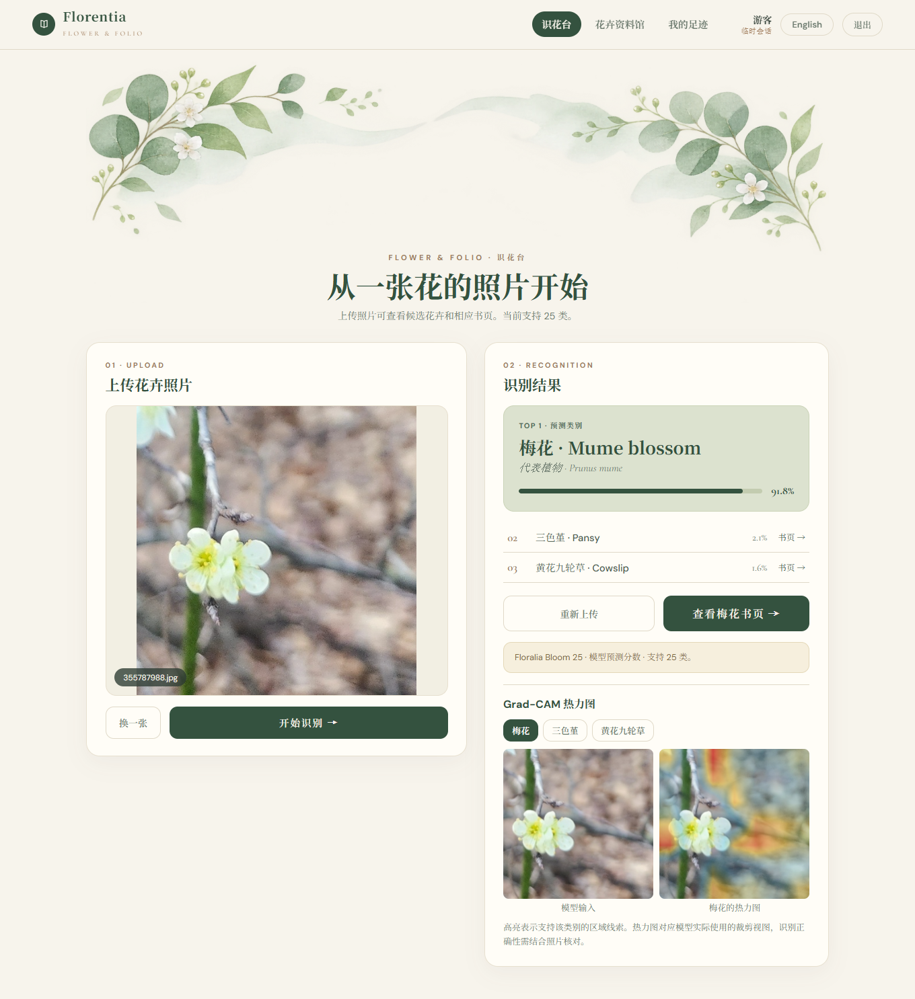
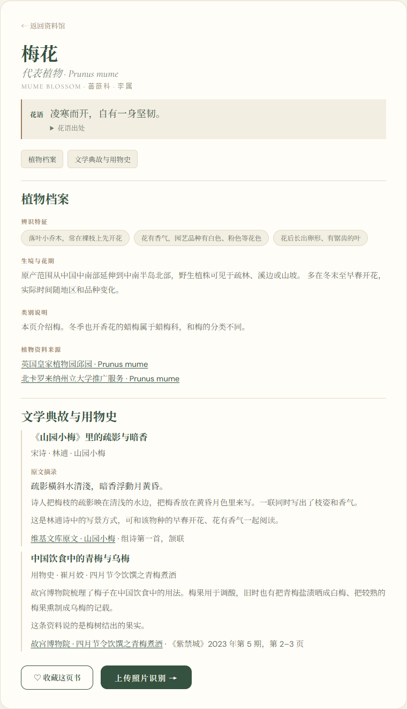
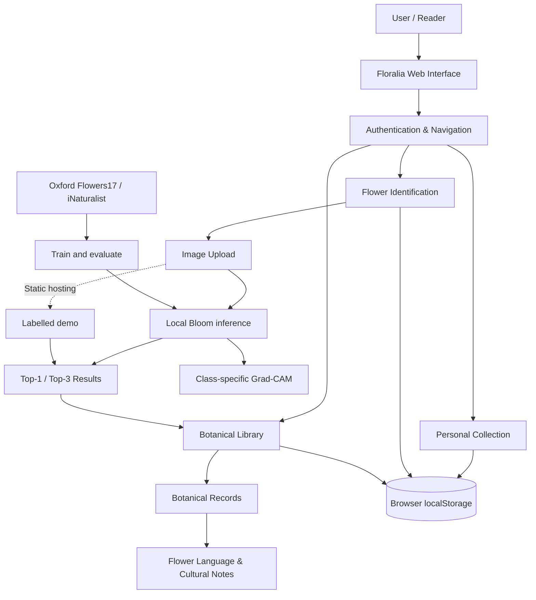

# 🌿 Floralia Library

<div align="center">


# Floralia Library
### 花与书页 · An AI-Powered Botanical & Literary Library

**Where Flowers Bloom, Stories Unfold.**

*让一朵花，翻开一页书。*

An exploration of **flower recognition, botanical knowledge, and the literature hidden within nature.**


</div>

---

## 📖 About Floralia

**Floralia Library** is a flower-recognition and botanical library that brings together **computer vision, botany, literature, and the history of plant use**.

Inspired by classical European libraries and botanical manuscripts, the project reimagines flower identification as the experience of opening an illustrated book.

A photograph opens a folio with the flower’s scientific identity, distinguishing characteristics, and sourced readings on literature or historical uses.

Rather than ending with a classification label, Floralia aims to invite further exploration.

> *Every flower has a name. Some have stories worth remembering.*

### 🌸 项目简介

**Floralia Library · 花与书页** 是一个融合计算机视觉、植物学与文学文化的花卉智能识别项目。

项目以欧洲古典藏书馆和植物图鉴为设计灵感，将花卉识别转化为一次翻阅书页的体验。

用户上传花卉照片后，可以进入相应的植物资料页面，探索：

- **植物学信息**：中英文名称、学名、科属、形态特征、分布与花期。
- **花卉识别**：基于深度学习的类别预测及 Top-3 候选结果。
- **一句花语**：每种花配一条中英短句，可展开核对传统出处。
- **文学典故**：在诗文、小说、戏剧和有出处的故事中查阅花卉意象。
- **用物史**：了解花、果实等植物部位在饮食、香料和日常工艺中的用途。
- **个人收藏**：保存喜爱的花卉书页，回顾探索记录。

资料馆收录 25 张中英双语书页。为本机配置 **Floralia Bloom 25** 后，识花台支持 25 类预测、Top-3、Grad-CAM 和书页跳转。见[本机识花运行说明](docs/model.md)和[扩展实验报告](docs/bloom25.md)。

## 实机截图 · Screenshots

**从一张照片到三个候选。** 本机运行 Floralia Bloom 25，从留出集的一张梅花实拍图得到首选「梅花」，预测分数为 91.8%。图中也可看到模型实际使用的裁剪和所选类别的 Grad-CAM。[实拍图 iNaturalist 观测记录](https://www.inaturalist.org/observations/201540541) · [照片 CC0](https://creativecommons.org/publicdomain/zero/1.0/)



**从候选翻到书页。** 梅花页开头有一句花语，下方可读林逋的宋诗和中国用梅果调味的用物史。



### 当前开发状态（2026-11）

- Oxford Flowers17 的 0–16 类映射已统一，第一组官方划分已在本地核对；映射和生成脚本见 [`knowledge/classes.json`](knowledge/classes.json)、[`src/prepare_flower17.py`](src/prepare_flower17.py)。原始图片与划分文件不提交到仓库。
- 本机服务使用可用的 25 类或 17 类权重运行真实识别，静态托管提供带标注的演示模式。25 张书页均有植物档案，文学典故与用物史按来源逐条收录。[资料收录裁定](docs/knowledge.md#资料收录裁定)
- MinerU 4.2.3 文献解析最小闭环已完成：文本 PDF、扫描 PDF、PNG 图片在本机验证，可输出 Markdown、Middle JSON、Structured Content JSON 和来源元数据。用法见 [`docs/mineru.md`](docs/mineru.md)。
- Qt6/QML 文献界面、知识自动提取、识花联动和 RAG 检索仍属于后续阶段。
- SQLite 知识库已具备建表、初始资料导入、CRUD 和 MinerU 解析登记入口。见 [数据库设计](docs/database.md)。
- 本机书页可以用 Hy-MT2 生成英译中初稿，独立审核后展示。见 [本机翻译启动说明](docs/translation.md)。

---

## ✨ Features

### 📷 Flower Recognition · 智能识花

Upload a flower photograph and explore its possible identity.

- Drag-and-drop image upload
- JPG, PNG and WebP support
- Image preview and recognition interaction
- Top-1 prediction and Top-3 candidate display
- Direct navigation to botanical records

The app offers English and Simplified Chinese across 25 folios. With local weights, Floralia Bloom 25 extends the original MobileNetV3 Small classifier by eight categories. The static site shows a labelled demo. See the [local inference setup](docs/model.md) and [25-category evaluation](docs/bloom25.md).

### 🌿 Botanical Encyclopedia · 植物资料馆

A digital collection inspired by historical botanical encyclopedias.

Each flower entry may contain:

| Category | Description |
|---|---|
| Botanical Identity | Chinese name, English name, scientific name and family |
| Identification | Distinguishing morphological features |
| Distribution & Season | Habitat, distribution and flowering period |
| Literary Heritage | Sourced poetry, fiction, drama and legends |
| History of Use | Documented uses in food, fragrance and everyday crafts |
| Personal Collection | Bookmarks and browsing records |

The collection contains **25 bilingual folios** covering all 17 Oxford Flowers17 categories and eight additional flowers.

Scientific names, flowering periods and other botanical details are subject to further source verification.

### 📜 Flowers in Literature · 花与文学

书页的阅读栏收录中国和西方的文学典故与用物史。读者可以在梅花页读宋诗与青梅的饮食史，也可以在蓝铃花页读英国林地传说与旧书装订的历史。条目附出处、定位与相关植物部位。[资料收录裁定](docs/knowledge.md#资料收录裁定)

### 📚 Personal Library · 我的花之书页

A personal space for collecting discoveries.

- Account registration, sign-in, and guest access
- Flower browsing and identification history
- Favourite flower entries
- Per-account local records
- Searchable botanical collection

Registered readers' data uses the browser's `localStorage`. Guest history and favourites use `sessionStorage` and are cleared on guest sign-out.

---

## 🎨 Design Philosophy

Floralia follows the visual language of **classical European botanical illustrations and private libraries**.

The interface combines:

- Soft ivory and parchment backgrounds
- Forest-green typography and navigation
- Muted gold accents
- Elegant serif typography
- Watercolour botanical illustrations
- Book-inspired cards and reading layouts

The intention is to create a digital reading experience that feels like exploring an old botanical manuscript.

**Typography:** Cormorant Garamond · Noto Serif SC · DM Sans

**Design identity:** Botanical · Literary · Classical · Minimal

---

## 🛠 Technology Stack

### Currently Implemented

| Layer | Technologies |
|---|---|
| Frontend | HTML5, CSS3, JavaScript ES2020+ |
| Architecture | Vanilla JavaScript SPA |
| Routing | Custom Hash Router with route guards |
| Persistence | Browser `localStorage` |
| UI Styling | CSS Custom Properties, Responsive Design |
| Assets | WebP, SVG |
| Development Server | Local Python inference server |
| Datasets | Oxford Flowers17 and curated iNaturalist observations |

The Web application requires no JavaScript framework, package manager or build system.

### Model and Document Processing

| Component | Technologies |
|---|---|
| Deep Learning | PyTorch, torchvision |
| Classification | ResNet18 teacher and MobileNetV3-Small student |
| Transfer Learning | Frozen-backbone and partial fine-tuning experiments |
| Dataset Processing | Pillow, NumPy, SciPy |
| Explainable AI | Grad-CAM |
| Document Processing | MinerU, SQLite |

---

## 🏛 System Architecture



**Architecture notes**

The current frontend consists of independent modules for data, storage, routing, and page rendering.

- `data.js` manages botanical entries and demonstration predictions.
- `store.js` encapsulates local account, history and favourite operations.
- `router.js` handles navigation, route parameters and authentication guards.
- `views/` contains the page-specific interfaces.

The local identification page calls `POST /api/identify` and maps returned category keys to the existing folios.

A backend and secure account system will be required before production deployment.

---

## 算法与测试 · Models and Evaluation

1. **迁移学习。** 从 ImageNet 预训练的 ResNet18 出发，用 Oxford Flowers17 官方第一组划分（训练 680、验证 340、测试 340）。A 组只训练分类头并固定主干 BatchNorm 的运行统计量，B 组再解冻最后一个残差阶段。验证集原图 Top-1 分别为 **90.9%** 和 **93.2%**。
2. **蒸馏对照。** S0 用真实标签训练 MobileNetV3-Small 的分类层。S1 在同样的训练起点增加 B 组教师的软标签，温度为 3，教师损失权重为 0.3。五个随机种子成对重跑后，原图验证集的平均 Macro-F1 为 S0 **0.9446**、S1 **0.9367**，S1 五对中有一对提高。
3. **微调与部署。** S2 让学生模型末段的一部分参与微调。Floralia Bloom 1.0 用 **25% S0 + 75% S2** 合并参数，一次前向计算即可推理。官方第一组测试原图上，混合模型与 S0 的 Top-1 均为 321/340，混合模型的 Top-3 多命中一张。低光、强光、模糊、遮挡和紧裁由同批照片生成，按条件分别统计。[17 类模型与评估说明](docs/model.md)
4. **扩展到 25 类。** Bloom 25 沿用原模型特征提取层，训练 25 类输出层。训练回放旧类样本并使用旧模型的软标签。新类照片从 iNaturalist 筛选，按摄影者分组后分成 435 张训练、109 张验证、111 张留出测试。以验证集各类别等权的首选准确率选中第 20 轮，再报告留出集成绩。[重跑命令和逐类结果](docs/bloom25.md)

| 测试集 | 模型 | Top-1 · 首选正确 | Top-3 · 前三命中 |
|---|---|---:|---:|
| Oxford 官方第一组，原有 17 类 340 张 | Bloom 1.0 | 321/340（94.4%） | 336/340（98.8%） |
| 同一批 Oxford 原图 | Bloom 25 | 323/340（95.0%） | 336/340（98.8%） |
| iNaturalist 留出集，新增 8 类 111 张 | Bloom 25 | 90/111（81.1%） | 105/111（94.6%） |

**本机复核。** 上传两张留出集梅花照片，样本一的首选为梅花（91.8%），并走通 Top-3、Grad-CAM 和书页跳转。样本二的首选是牡丹（34.6%），梅花排第二（26.6%），界面显示低分提示。梅花留出集总共 8 张，首选正确 4 张。Grad-CAM 对应模型实际看到的 224 × 224 裁剪区域，便于核对它对指定候选使用的图像线索。[样本一](https://www.inaturalist.org/observations/201540541) · [样本二](https://www.inaturalist.org/observations/19411279) · [逐类结果](docs/bloom25.md)

### 参考论文与用途

| 论文或数据来源 | 在项目中的用途 |
|---|---|
| He 等，2016，[Deep Residual Learning for Image Recognition](https://doi.org/10.1109/CVPR.2016.90) | ResNet18 教师的主干，迁移学习 A/B 的共同起点。 |
| Howard 等，2019，[Searching for MobileNetV3](https://openaccess.thecvf.com/content_ICCV_2019/html/Howard_Searching_for_MobileNetV3_ICCV_2019_paper.html) | 通过 torchvision 使用 MobileNetV3-Small 作为学生与部署模型。 |
| Hinton 等，2015，[Distilling the Knowledge in a Neural Network](https://arxiv.org/abs/1503.02531) | 用温度软化教师分数，比较学生有无教师项的效果。 |
| Lakshminarayanan 等，2017，[Deep Ensembles](https://arxiv.org/abs/1612.01474) | 参考预测集成思路，做过候选概率和原始分数加权的单独对照。 |
| Wortsman 等，2022，[Model Soups](https://proceedings.mlr.press/v162/wortsman22a.html) | 参考同结构模型的权重平均思路，试验 S0 与 S2 的混合权重。 |
| Selvaraju 等，2017，[Grad-CAM](https://openaccess.thecvf.com/content_ICCV_2017/html/Selvaraju_Grad-CAM_Visual_Explanations_ICCV_2017_paper.html) | 为指定识别候选显示类别响应热力图。 |
| Borsch 等，2020，[World Flora Online](https://doi.org/10.1002/tax.12373) | 参考学名、分类与来源的组织方式。 |
| Joly 等，2014，[Interactive Plant Identification Based on Social Image Data](https://www.documentation.ird.fr/hor/PAR00012198) | 参考 Pl@ntNet 用实地观察照片辅助植物辨识的做法。 |
| Garcin 等，2021，[Pl@ntNet-300K](https://datasets-benchmarks-proceedings.neurips.cc/paper_files/paper/2021/hash/7e7757b1e12abcb736ab9a754ffb617a-Abstract-round2.html) | 参考逐类报告样本量与相似类别问题。项目实际训练数据来自 [Oxford Flowers17](https://www.robots.ox.ac.uk/~vgg/data/flowers/17/) 和 [iNaturalist](https://github.com/inaturalist/inaturalist-open-data)。 |

蒸馏与参数混合是将论文方法应用于花卉识别的对照实验。逐轮、逐种子与逐图日志保存在本机。[训练脚本](src/train_bloom25.py) · [数据审计](reports/data_audit.md) · [测试汇总](docs/bloom25.md)

---

## 📂 Project Structure

```text
Floralia-Library/
├── README.md
├── index.html                  # Web application entry point
├── css/
├── js/                         # Views, routing and generated folio data
├── assets/                     # Illustrations and screenshots
├── knowledge/                  # Botanical and cultural sources
├── src/                        # Inference, training and document processing
├── tests/
├── docs/                       # Setup and evaluation notes
└── reports/                    # Dataset audit and category mapping
```

Local datasets and model checkpoints are stored outside Git. The local development copy can also serve frontend files from a `web/` directory.

---

## 🚀 Getting Started

### Prerequisites

- Python 3.12 with PyTorch, Torchvision and Pillow for local inference
- A modern browser such as Chrome, Edge or Firefox

No Node.js or npm installation is required.

### 1. Clone the Repository

```bash
git clone https://github.com/stellablack528/Floralia-Library.git
cd Floralia-Library
```

### 2. Launch the Web Application

Place the verified model checkpoint as described in [local inference setup](docs/model.md). Run from the project root.

**Windows**

```powershell
.\.venv\Scripts\python.exe -B src\serve_floralia.py
```

**macOS / Linux**

```bash
python3 -B src/serve_floralia.py
```

Open your browser at:

**http://127.0.0.1:8501/**

### 3. Explore Floralia

1. Continue as a guest or create a local demonstration account.
2. Visit the identification page and upload a flower image.
3. Compare the three candidates returned by the active Floralia Bloom model.
4. Open the corresponding botanical records.
5. Browse, search and bookmark flower entries.
6. Review your history in the personal collection.

> The local service supports 25 or 17 categories according to the loaded checkpoint. Static hosting shows a labelled demo.

---

## 📊 Development Progress

### ✅ Completed

- [x] Floralia-inspired classical botanical interface
- [x] Responsive, framework-free Web application
- [x] Custom Hash Router and authentication guards
- [x] Local demonstration account registration and login
- [x] Drag-and-drop image upload and preview
- [x] Deterministic demonstration recognition
- [x] Top-1 and Top-3 result presentation
- [x] Botanical library covering 25 flower categories
- [x] Source-linked literary and historical-use entries
- [x] Searchable botanical records
- [x] Personal history and favourites
- [x] Per-account local data separation
- [x] Global notification system

### 🚧 In Progress / Next Steps

- [x] Audit the official dataset split and complete the ResNet18 transfer-learning comparison
- [x] Compare student variants across five random seeds and report held-out metrics
- [ ] Evaluate low-confidence prediction handling
- [x] Integrate real inference into the local Web interface
- [x] Generate and display Grad-CAM explanations

### 🌱 Future Development

- [ ] Verify scientific names and botanical records
- [ ] Build a sourced literary and mythology collection
- [ ] Expand supported flower categories
- [ ] Explore Oxford Flowers102
- [ ] Investigate probability calibration and unknown-class detection
- [ ] Implement a backend authentication system
- [ ] Enable cross-device collection synchronisation
- [ ] Automate experimental reporting and visualisation

---

## 📚 Botanical & Literary Sources

Floralia treats botanical identification and cultural interpretation as related but distinct domains.

**Botanical references**

- [Plants of the World Online — Royal Botanic Gardens, Kew](https://powo.science.kew.org/)
- [Flora of China](https://www.iplant.cn/frps)
- Oxford Flowers17 dataset

**Literary references**

- [Project Gutenberg](https://www.gutenberg.org/)
- [Chinese Text Project](https://ctext.org/)

Flower-language interpretations may vary across historical periods, regions and literary traditions.

Scientific identification is also distinct from a dataset's broad classification labels. Botanical records and literary references will be verified progressively, and unsupported claims will remain explicitly marked as pending.

---

## 🎯 Project Vision

Floralia Library is both a software engineering project and an exploration of how technology can make natural history more engaging.

Its development brings together three complementary goals:

**Computer Vision** — Build and evaluate a reproducible flower-classification pipeline.

**Knowledge Organisation** — Transform classification results into structured, accessible botanical records.

**Digital Humanities** — Connect scientific information with the cultural and literary histories of flowers.

The long-term vision is a personal botanical library where users can discover a flower, learn to recognise it, and explore the stories associated with it.

---

## 👩‍💻 Author

Created and maintained by [@stellablack528](https://github.com/stellablack528).

Feedback, suggestions, and code reviews are welcome.

---

## 📄 License

This project is licensed under the MIT License. See [LICENSE](LICENSE) for details.

---

<div align="center">

### 🌷 Floralia Library

*Where Flowers Bloom, Stories Unfold.*

**A little library for flowers, knowledge, and the stories they carry.**

</div>
